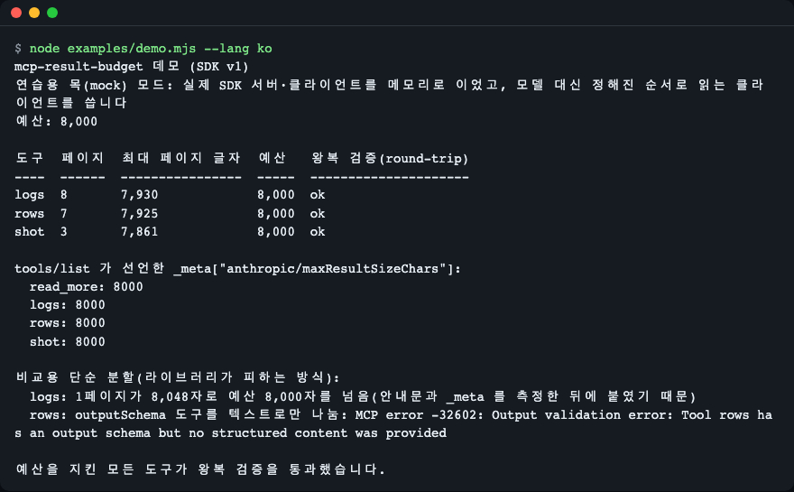
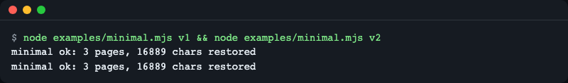
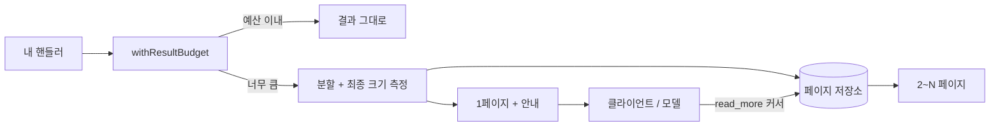
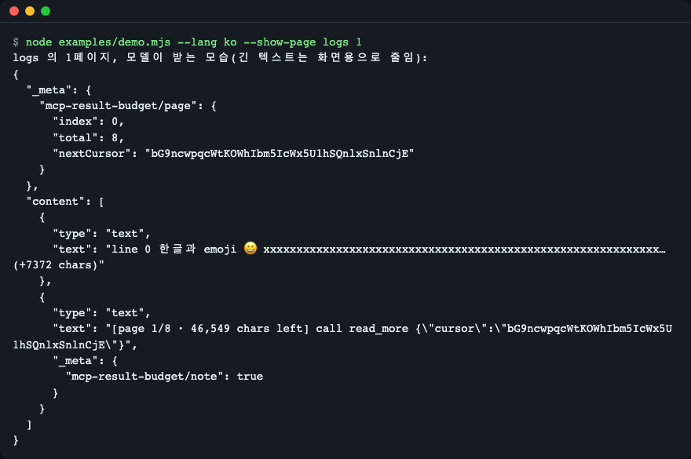

# mcp-result-budget

[English](README.md) | **한국어**

큰 MCP 도구 결과가 어느 클라이언트에서든 같은 방식으로 전달되게 해 주는 라이브러리입니다. TypeScript MCP 서버를 감싸서, 큰 결과를 크기 예산에 맞는 페이지로 나누고, 모델이 `read_more` 도구로 이어 읽으면 원본이 그대로 복원됩니다. 페이지마다 `outputSchema` 를 지키고 이미지 블록은 통째로 보존합니다.



*데모(연습용 목(mock) 모드, 실제 SDK 서버와 클라이언트를 메모리로 연결): 모든 페이지가 예산 안에 있고 왕복 검증이 `ok` 입니다.*

## 설치

```bash
npm install mcp-result-budget zod @modelcontextprotocol/sdk      # SDK v1
# 또는 SDK v2:
npm install mcp-result-budget zod @modelcontextprotocol/server
```

패키지가 npm 레지스트리에 올라오기 전에는 아래 clone 방법을 쓰세요.

런타임: Node 20 이상. 런타임 의존성 없음. 피어: `zod` 와 MCP SDK 하나 — `@modelcontextprotocol/sdk` 1.32.2 이상(v1) 또는 `@modelcontextprotocol/server` 2.4.0 이상(v2). clone 해서 써 보려면: `git clone https://github.com/LeeGyeongPil/mcp-result-budget && cd mcp-result-budget && npm install && npm run demo`.

## 빠르게 시작하기

평소 서버에 한 줄을 더합니다. 도구를 등록하기 전에 `withResultBudget` 를 한 번 부르면 되고, 나머지는 그대로입니다.

```js
import { z } from "zod";
import { McpServer } from "@modelcontextprotocol/sdk/server/mcp.js";
import { withResultBudget } from "mcp-result-budget";

const server = new McpServer({ name: "search-server", version: "1.0.0" });
withResultBudget(server, { maxChars: 8000 }); // 1번째 줄: 도구를 등록하기 전에

const big = Array.from({ length: 2000 }, (_, i) => `row ${i}`).join("\n");
server.registerTool("search", { description: "big result", inputSchema: z.object({}) }, async () => ({
  content: [{ type: "text", text: big }], // 2번째 줄: 핸들러는 그대로
}));
```

메모리 클라이언트까지 포함해 바로 돌아가는 전체 코드는 [`examples/minimal.mjs`](examples/minimal.mjs) 입니다. SDK v1·v2 에서의 실제 출력:

```text
minimal ok: 3 pages, 16889 chars restored
minimal ok: 3 pages, 16889 chars restored
```



*같은 코드가 두 세대 SDK 에서 전체 텍스트를 복원합니다.*

## 핵심 개념

1. **예산.** 제한은 최종 결과, 즉 라이브러리가 안내문과 `_meta` 를 붙인 뒤의 `JSON.stringify(result).length` 에 적용됩니다. 처음 나눈 결과를 다시 재서 맞을 때까지 줄입니다.
2. **페이지와 `read_more`.** 첫 호출은 1페이지와 `[page 1/8 · 46,549 chars left] call read_more {"cursor":"..."}` 같은 안내를 돌려줍니다. 모델이 그 커서로 `read_more` 를 부릅니다. 핸들러는 한 번만 실행되고 나머지 페이지는 저장소에서 나옵니다.
3. **분할 규칙.** 텍스트는 줄 단위, 그다음 코드 포인트 단위로 나눕니다. 압축된 최상위 JSON 배열은 다시 직렬화하지 않고 원소 경계에서 나눕니다. `structuredContent` 는 가장 큰 배열 기준으로 나누고 페이지마다 `outputSchema` 로 검사합니다. 이미지 같은 비텍스트 블록은 자르지 않습니다.
4. **클라이언트마다 같은 규칙.** 클라이언트는 파일로 빼거나, 자르거나, 전송에 실패하는 등 제각각입니다. 서버에서 프로필이나 숫자를 한 번 정하면 됩니다.





*`logs` 도구의 1페이지: `_meta` 의 페이지 표식과, 커서가 든 별도 안내 블록.*

## API

`mcp-result-budget` 의 공개 항목:

| 이름 | 하는 일 | 주요 인자 | 반환 |
|---|---|---|---|
| `withResultBudget(server, options?)` | `server.registerTool` 을 감싸고 `read_more` 를 등록하며 `_meta` 를 선언. 도구 등록 전에 한 번만 호출 | `registerTool` 이 있는 `server`, 아래 `options` | `ResultBudget` (`maxChars`, `paginate(tool, result)`) |
| `profiles` | 클라이언트 한도 표. 항목마다 `source` URL 과 `checked` 날짜 | 키 `agent-cli`, `codex`, `gemini-cli`, `http-1mib`, `portable` | 키별 `ClientProfile` |
| `resolveBudget(opts)` | `profile` / `maxChars` / `maxBytes` / `charsPerToken` 을 숫자로 바꿈 | 위 옵션 | `{ maxChars, maxBytes? }` |
| `MemoryPageStore` | TTL, LRU 제거, 전체 크기 상한이 있는 프로세스 내 저장소(최신 항목은 항상 유지) | `{ ttlMs = 600000, maxEntries = 100, maxTotalChars = 32000000, now }` | `PageStore` |
| `defaultNote(info)` | 기본 안내문. 직접 만드는 `note` 안에서 쓸 수 있음 | `PageInfo` | `string` |
| `BudgetConfigError` | 잘못된 옵션(범위 밖 `maxChars`, 이름 충돌, `registerTool` 없음, 이중 감싸기)에서 던짐 | | `Error` |
| `PAGE_META`, `PART_META`, `NOTE_META`, `DECLARE_META` | `_meta` 키 이름 | | `string` |

`ResultBudgetOptions` (모두 선택):

| 옵션 | 기본값 | 뜻 |
|---|---|---|
| `profile` | `"portable"` | 클라이언트 프로필에서 예산을 가져옴 |
| `maxChars` | 프로필 값 | 글자 수 예산, 1,000~500,000 정수 |
| `maxBytes` | 프로필 값 | 바이트 한도도 함께 지정(선택, UTF-8 크기가 맞을 때까지 비율로 줄이며 못 맞추면 `budget-not-met` 경고, 최솟값 1,000) |
| `charsPerToken` | `1` | 토큰 한도를 글자 수로 환산 |
| `continuationTool` | `"read_more"` | 이어 읽기 도구 이름 |
| `store` | `MemoryPageStore` | `get` / `set` / `delete` 가 있는 객체(`PageStore`) |
| `declareMeta` | `true` | 감싼 도구마다 `_meta["anthropic/maxResultSizeChars"]` 추가. `read_more` 는 전역 예산과 `perTool` 예산 중 큰 값을 선언 |
| `perTool` | `{}` | `{ tool: { maxChars } }` 로 덮어쓰기, `{ tool: false }` 로 제외 |
| `errorPolicy` | `"trim"` | `"trim"` 은 큰 오류 텍스트를 줄이고 `"pass"` 는 그대로 둠 |
| `note` | `defaultNote` | 안내 블록 문장을 직접 만듦 |
| `onWarning` | 없음 | `BudgetWarning` 객체를 받음 |

경고 코드: `unsplittable-structured`, `unsupported-shape`, `oversize-atomic`, `error-trimmed`, `budget-not-met`, `unwrapped-tool`(`withResultBudget` 이전에 등록했거나 구형 `server.tool()` 로 등록한 도구).

`mcp-result-budget/testing` 의 공개 항목:

| 이름 | 하는 일 | 주요 인자 | 반환 |
|---|---|---|---|
| `readAllPages(client, call, opts?)` | 도구를 부르고 커서를 끝까지 따라감 | `{ name, arguments }`, `continuationTool`, `maxPages` | `{ pages, text, blocks, structured }` |
| `expectRoundTrip(client, call, opts)` | 예산 초과·오류 페이지·연결 끊김·`outputSchema` 위반, 그리고(`original` 이 있으면) 원본 복원 실패를 잡아 실패시킴 | `{ maxChars, original?, outputSchema?, continuationTool? }` | `Promise<void>`, `RoundTripError` 를 던짐 |
| `RoundTripError` | `violations` 를 담음, 항목은 `{ page, kind, detail }` | | `Error` |

위반 종류: `over-budget`, `text-mismatch`, `block-missing`, `structured-mismatch`, `schema`, `is-error`, `chain`. 페이지 번호는 1부터 셉니다.

## 사용 예

**1. 모든 클라이언트에 하나의 예산.** `profile: "portable"`(기본값)은 다른 프로필 중 가장 작은 한도를 써서 어디서나 안전합니다. 2026-11-18 에 확인한 프로필:

```js
import { profiles } from "mcp-result-budget";
console.log(profiles.portable);
```
```text
{
  tokens: 12000,
  chars: 40000,
  bytes: 1048576,
  source: 'https://code.claude.com/docs/en/mcp.md',
  checked: '2026-11-18',
  note: 'Smallest limit of the other profiles, so one setting is safe everywhere.'
}
```

실제 예산은 토큰 한도와 글자 한도 중 작은 값입니다. `resolveBudget({ profile: "portable" })` 은 `{ maxChars: 12000, maxBytes: 1048576 }` 을 돌려줍니다(토큰 12,000 × 토큰당 1글자). `chars` 의 40,000 이 아닙니다.

**클라이언트 프로필.** `profile` 에는 아래 키를 씁니다. 값은 2026-11-18 에 각 클라이언트 문서나 이슈에서 확인한 것이고, `agent-cli` 는 명령줄 코딩 에이전트 클라이언트입니다. 숫자를 믿기 전에 항목의 출처(`profiles[이름].source`)를 확인하세요.

| 프로필 | 대상 | 사용 한도 | 출처 |
|---|---|---|---|
| `agent-cli` | 기본 한도 25,000 토큰(`MAX_MCP_OUTPUT_TOKENS`), 50,000자를 넘는 텍스트는 파일로 저장하는 명령줄 코딩 에이전트 클라이언트 | 25,000 토큰, 50,000자 | `https://code.claude.com/docs/en/mcp.md` |
| `codex` | Codex CLI | 12,000 토큰(문서의 기본값이 아니라 샘플 설정의 값) | `https://learn.chatgpt.com/docs/config-file/config-sample` |
| `gemini-cli` | Gemini CLI | 40,000자(설정 문서의 외부 미러에서 확인) | `https://www.mintlify.com/google-gemini/gemini-cli/reference/settings` |
| `http-1mib` | 스트리밍 HTTP 에서 이벤트를 1 MiB 로 제한하는 클라이언트(공식 Python 클라이언트에서 보고됨) | 1,048,576 바이트 | `https://github.com/MysterionRise/pubchem-finder/issues/201` |
| `portable`(기본값) | 모르는 클라이언트 전부 | 위 값 중 가장 작은 것: 12,000자, 1,048,576 바이트 | 계산값 |

`charsPerToken: 1`(기본값)이면 토큰 한도를 글자 수로 그대로 써서 안전한 쪽입니다.

클라이언트 한도는 바뀝니다. 항목마다 출처와 확인 날짜가 있으니 숫자를 믿기 전에 다시 확인하세요.

**2. 도구가 자기 한도를 선언.** `tools/list` 에 예산과 같은 `_meta["anthropic/maxResultSizeChars"]` 가 나와서, 이 값을 읽는 클라이언트는 페이지를 파일로 빼지 않습니다:

```text
[
  [ 'read_more', { 'anthropic/maxResultSizeChars': 12000 } ],
  [ 'search', { 'anthropic/maxResultSizeChars': 12000 } ]
]
```

**3. 내 서버 검증.** 테스트에서 `expectRoundTrip` 을 씁니다(6만 자 결과를 가진 서버의 실제 출력):

```js
import { expectRoundTrip } from "mcp-result-budget/testing";

await expectRoundTrip(client, { name: "search" }, {
  maxChars: 12000,
  original: { content: [{ type: "text", text: big }] },
}); // 조용히 통과
```

한도를 너무 작게 주면 던지고, 페이지 번호와 종류를 알려 줍니다:

```text
RoundTripError { page: 1, kind: 'over-budget', detail: '11,875 > 5,000' }
```

**4. 잘못된 커서도 예외 없음.** 모르는·위조된·만료된 커서는 `isError: true` 와 도구 이름이 든 안내(커서를 읽을 수 없으면 원래 도구를 다시 부르라는 안내)를 돌려주므로 모델이 다시 부를 수 있습니다.

## 언제 쓰나

- 잘 맞는 경우: 큰 텍스트·JSON 배열·`structuredContent` 를 돌려줄 수 있는 도구를 가진 TypeScript MCP 서버를 만들고, 모든 클라이언트에서 같은 동작과 "잃는 것이 없다"는 테스트가 필요할 때.
- 다른 도구: [mcp-pager](https://www.npmjs.com/package/mcp-pager) 도 서버 안에서 쪽 나누기를 하는 패키지입니다. 지원하는 SDK 버전과 결과 형식은 그쪽 문서를 확인하세요. 서버를 고칠 수 없다면 앞단 프록시가 다른 방법입니다. Python 서버는 Python 라이브러리가 필요합니다.
- 아직 없는 것: 실제 토크나이저(예산은 글자 수 기준), Redis 같은 공유 저장소(`PageStore` 를 직접 구현).

## 데모와 언어

```bash
npm install
npm run demo                  # 연습용 목(mock) 모드, 영어
npm run demo -- --lang ko     # 한국어
npm run demo -- --sdk v2      # v1 대신 SDK v2
npm run demo -- --show-page logs 1   # "logs" 도구의 1쪽을 모델이 받는 모습 그대로
```

데모 언어: `--lang en|ko`, 다음 `MCP_RESULT_BUDGET_LANG`, 다음 `LC_ALL` / `LC_MESSAGES` / `LANG` 순이고, 한국어가 아니면 영어입니다. 데모는 연습용 목(mock) 모드입니다. 실제 SDK 서버와 클라이언트를 메모리로 이었고, 모델 대신 항상 커서를 따라가는 정해진 클라이언트를 씁니다. 실제 모델은 중간에 멈출 수 있습니다. 라이브러리 자체의 메시지와 안내문은 영어이며, `note` 로 바꿀 수 있습니다.

## 문제 해결

| 증상 | 원인 | 해결 |
|---|---|---|
| `BudgetConfigError: ... already wrapped` | `withResultBudget` 를 두 번 호출 | 서버당 한 번만 호출 |
| 도구 이름에 관한 `BudgetConfigError` | `read_more` 가 내 도구와 겹침 | `continuationTool` 지정 |
| 호출 전에 등록한 도구가 나뉘지 않음, `unwrapped-tool` 경고 | 이후의 `registerTool` 만 감싸짐 | `withResultBudget` 를 먼저 호출 |
| `server.tool()` 도구에 `unwrapped-tool` 경고 | 구형 v1 `server.tool()` 도구도 나뉘지만 `_meta`·`outputSchema` 를 선언할 수 없어 크기 선언이 없음 | `registerTool` 로 바꿈 |
| 페이지에서 `Output validation error` | 다른 분할기가 `outputSchema` 도구를 텍스트만으로 나눔 | 이 라이브러리를 사용. 스키마가 분할을 막으면 원본 결과와 `unsplittable-structured` 경고를 받음 |
| `oversize-atomic` 경고 | 이미지·리소스 블록이 예산보다 큼 | 단독 페이지로 통째 전송됨. 이미지를 줄이거나 예산을 늘림 |
| "call `search` again" 이 든 `isError` | 커서 만료(기본 10분) 또는 프로세스 재시작 | 원래 도구를 다시 호출하거나 `ttlMs` 가 더 긴 저장소를 지정 |

## 버전·호환성

유의적 버전(SemVer)을 따릅니다. 0.x 동안은 마이너 버전에서 API 가 바뀔 수 있고, 바뀌면 [CHANGELOG.md](CHANGELOG.md) 에 적습니다. `@modelcontextprotocol/sdk` 1.32.2, `@modelcontextprotocol/server` 2.4.0, Node 26.13.0 에서 시험했고 최소 지원 Node 는 20 입니다. JSON 배열 페이지는 원소 원문을 유지하며, 이 경우 복원 결과는 바이트 동일이 아니라 깊은 동등입니다.

## 개발·기여

```bash
npm install
npm test            # 파일 10개, 테스트 46개, 각각 SDK v1·v2 로 실행
npm run typecheck
npm run build
npm run smoke:pack  # 묶은 tarball 을 각 SDK 와 설치해 예제를 실행
```

개발에는 Node 22.12 이상이 필요합니다(vitest 5).

## 라이선스

MIT.
