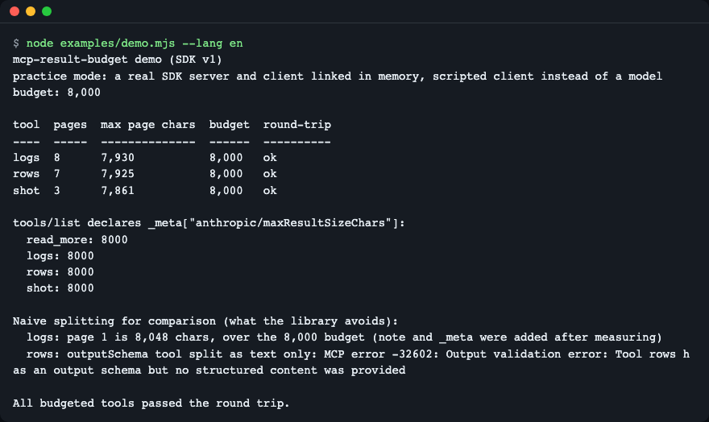
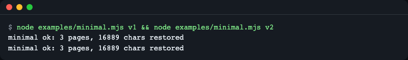
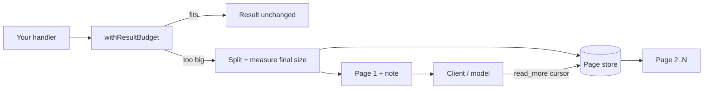
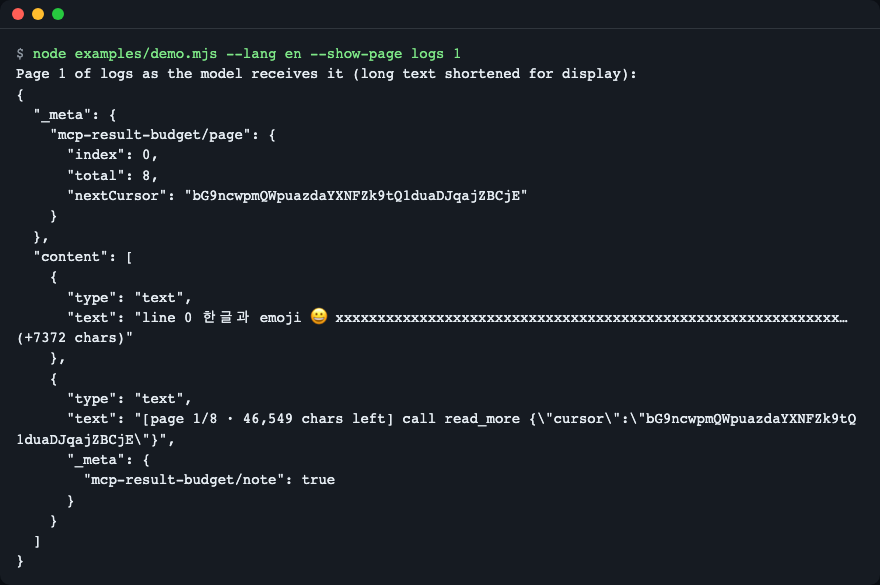

# mcp-result-budget

**English** | [한국어](README.ko.md)

Make large MCP tool results behave the same way in every client. `mcp-result-budget` wraps a TypeScript MCP server so that a big result is split into pages that fit a size budget, the model reads on with a `read_more` tool, and the original comes back unchanged. It keeps `outputSchema` valid on every page and keeps image blocks whole.



*The demo (practice mock mode, a real SDK server and client linked in memory): every page stays within the budget and the round trip is `ok`.*

## Install

```bash
npm install mcp-result-budget zod @modelcontextprotocol/sdk      # SDK v1
# or, with SDK v2:
npm install mcp-result-budget zod @modelcontextprotocol/server
```

Until the package is on the npm registry, use the clone route below.

Runtime: Node 20+. No runtime dependencies. Peers: `zod` and one MCP SDK, either `@modelcontextprotocol/sdk` 1.32.2+ (v1) or `@modelcontextprotocol/server` 2.4.0+ (v2). To try it from a clone instead: `git clone https://github.com/LeeGyeongPil/mcp-result-budget && cd mcp-result-budget && npm install && npm run demo`.

## Quick start

Two lines are added to a normal server: one `withResultBudget` call before you register tools, and nothing else changes.

```js
import { z } from "zod";
import { McpServer } from "@modelcontextprotocol/sdk/server/mcp.js";
import { withResultBudget } from "mcp-result-budget";

const server = new McpServer({ name: "search-server", version: "1.0.0" });
withResultBudget(server, { maxChars: 8000 }); // line 1: before registering tools

const big = Array.from({ length: 2000 }, (_, i) => `row ${i}`).join("\n");
server.registerTool("search", { description: "big result", inputSchema: z.object({}) }, async () => ({
  content: [{ type: "text", text: big }], // line 2: your handler is unchanged
}));
```

A complete runnable version with an in-memory client is [`examples/minimal.mjs`](examples/minimal.mjs). Its real output, for the SDK v1 and v2:

```text
minimal ok: 3 pages, 16889 chars restored
minimal ok: 3 pages, 16889 chars restored
```



*The same code restores the full text on both SDK generations.*

## Core concepts

1. **Budget.** The limit applies to the final result, `JSON.stringify(result).length`, after the library has added its note and `_meta`. A first split is re-measured and tightened until it fits.
2. **Pages and `read_more`.** The first call returns page 1 plus a note such as `[page 1/8 · 46,549 chars left] call read_more {"cursor":"..."}`. The model calls `read_more` with that cursor. Your handler runs once; later pages come from a store.
3. **Splitting rules.** Text splits at lines, then code points. A compact top-level JSON array splits at element boundaries without re-serializing. `structuredContent` splits by its largest array and each page is checked against `outputSchema`. Images and other non-text blocks are never cut.
4. **Same rule for every client.** Clients differ (save to file, truncate, fail to send). Pick a profile or a number once on the server.





*Page 1 of the `logs` tool: a page marker in `_meta` and a separate note block with the cursor.*

## API

Exports of `mcp-result-budget`:

| Name | What it does | Main arguments | Returns |
|---|---|---|---|
| `withResultBudget(server, options?)` | Wraps `server.registerTool`, registers `read_more`, declares `_meta`. Call it once, before registering tools | `server` with `registerTool`; `options` below | `ResultBudget` (`maxChars`, `paginate(tool, result)`) |
| `profiles` | Table of client limits, each with `source` URL and `checked` date | keys `agent-cli`, `codex`, `gemini-cli`, `http-1mib`, `portable` | `ClientProfile` per key |
| `resolveBudget(opts)` | Turns `profile` / `maxChars` / `maxBytes` / `charsPerToken` into numbers | those options | `{ maxChars, maxBytes? }` |
| `MemoryPageStore` | In-process store with TTL, LRU eviction and a total-size cap (the newest entry is always kept) | `{ ttlMs = 600000, maxEntries = 100, maxTotalChars = 32000000, now }` | `PageStore` |
| `defaultNote(info)` | Default note text, usable inside your own `note` | `PageInfo` | `string` |
| `BudgetConfigError` | Thrown for bad options: out-of-range `maxChars`, name clash, no `registerTool`, double wrap | | `Error` |
| `PAGE_META`, `PART_META`, `NOTE_META`, `DECLARE_META` | `_meta` key names | | `string` |

`ResultBudgetOptions` (all optional):

| Option | Default | Meaning |
|---|---|---|
| `profile` | `"portable"` | Take the budget from a client profile |
| `maxChars` | from profile | Budget in characters, integer 1,000 to 500,000 |
| `maxBytes` | from profile | Optional byte limit as well |
| `charsPerToken` | `1` | Converts token limits to characters |
| `continuationTool` | `"read_more"` | Name of the reading tool |
| `store` | `MemoryPageStore` | Any object with `get` / `set` / `delete` (`PageStore`) |
| `declareMeta` | `true` | Add `_meta["anthropic/maxResultSizeChars"]` to each wrapped tool; `read_more` declares the larger of the global budget and any `perTool` budget |
| `perTool` | `{}` | `{ tool: { maxChars } }` to override, `{ tool: false }` to skip |
| `errorPolicy` | `"trim"` | `"trim"` shortens oversize error text, `"pass"` leaves it |
| `note` | `defaultNote` | Build your own note block text |
| `onWarning` | none | Receives `BudgetWarning` objects |

Warning codes: `unsplittable-structured`, `unsupported-shape`, `oversize-atomic`, `error-trimmed`, `budget-not-met`, `unwrapped-tool` (a tool registered before `withResultBudget`, or through the older `server.tool()`).

Exports of `mcp-result-budget/testing`:

| Name | What it does | Main arguments | Returns |
|---|---|---|---|
| `readAllPages(client, call, opts?)` | Calls a tool and follows cursors to the end | `{ name, arguments }`, `continuationTool`, `maxPages` | `{ pages, text, blocks, structured }` |
| `expectRoundTrip(client, call, opts)` | Fails if any page is over budget, an error, breaks the chain, fails `outputSchema`, or (with `original`) does not rebuild the original | `{ maxChars, original?, outputSchema?, continuationTool? }` | `Promise<void>`, throws `RoundTripError` |
| `RoundTripError` | Carries `violations`, each `{ page, kind, detail }` | | `Error` |

Violation kinds: `over-budget`, `text-mismatch`, `block-missing`, `structured-mismatch`, `schema`, `is-error`, `chain`. Pages are numbered from 1.

## Usage

**1. One budget for every client.** `profile: "portable"` (the default) uses the smallest limit among the other profiles, so it is safe everywhere. Profiles checked on 2026-11-18:

```js
import { profiles } from "mcp-result-budget";
console.log(profiles.portable);
```
```text
{
  tokens: 12000,
  chars: 40000,
  bytes: 1048576,
  source: 'https://code.claude.com/docs/en/mcp.md',
  checked: '2026-11-18',
  note: 'Smallest limit of the other profiles, so one setting is safe everywhere.'
}
```

The effective budget is the smaller of the token and character limits: `resolveBudget({ profile: "portable" })` gives `{ maxChars: 12000, maxBytes: 1048576 }` (12,000 tokens at 1 character per token), not the 40,000 in `chars`.

**Client profiles.** `profile` takes one of these keys. Values are what each client's documentation or issue tracker said on 2026-11-18; `agent-cli` is a command-line coding-agent client. Check the `source` of each entry (`profiles[name].source`) before relying on a number.

| Profile | Meant for | Limit used | Source note |
|---|---|---|---|
| `agent-cli` | A command-line coding-agent client with a default limit of 25,000 tokens (`MAX_MCP_OUTPUT_TOKENS`); text over 50,000 characters is saved to a file | 25,000 tokens, 50,000 chars | `https://code.claude.com/docs/en/mcp.md` |
| `codex` | The Codex CLI | 12,000 tokens (value from its sample config, not a documented default) | `https://learn.chatgpt.com/docs/config-file/config-sample` |
| `gemini-cli` | Gemini CLI | 40,000 chars (from a third-party mirror of its settings reference) | `https://www.mintlify.com/google-gemini/gemini-cli/reference/settings` |
| `http-1mib` | Clients with a 1 MiB event cap on streamable HTTP (reported for the official Python client) | 1,048,576 bytes | `https://github.com/MysterionRise/pubchem-finder/issues/201` |
| `portable` (default) | Any client you do not know | smallest of the above: 12,000 chars, 1,048,576 bytes | derived |

With `charsPerToken: 1` (the default) a token limit is used as a character count, which is on the safe side.

Client limits change. Each profile carries its source and check date; re-read them before relying on a number.

**2. Tools declare their own limit.** `tools/list` shows `_meta["anthropic/maxResultSizeChars"]` equal to the budget, so clients that read it do not save your pages to a file:

```text
[
  [ 'read_more', { 'anthropic/maxResultSizeChars': 12000 } ],
  [ 'search', { 'anthropic/maxResultSizeChars': 12000 } ]
]
```

**3. Test your own server.** Use `expectRoundTrip` in your test suite (real output of a server with a 60,000-character result):

```js
import { expectRoundTrip } from "mcp-result-budget/testing";

await expectRoundTrip(client, { name: "search" }, {
  maxChars: 12000,
  original: { content: [{ type: "text", text: big }] },
}); // passes silently
```

With a too-small limit it throws, naming the page and the kind:

```text
RoundTripError { page: 1, kind: 'over-budget', detail: '11,875 > 5,000' }
```

**4. Bad cursors never throw.** An unknown, tampered or expired cursor returns `isError: true` with a note naming the tool (or telling the model to call the original tool again if the cursor cannot be read), so the model can call it again.

## When to use it

- Good fit: you write a TypeScript MCP server whose tools can return large text, JSON arrays or `structuredContent`, and you want the same behavior in every client plus a test that proves nothing is lost.
- Other tools: [mcp-pager](https://www.npmjs.com/package/mcp-pager) is another server-side pagination package; check its docs for the SDK version and result types it supports. If you cannot change the server, a proxy in front of it is the other route. Python servers need a Python library.
- Not covered yet: a real tokenizer (budgets are characters), and shared stores such as Redis (implement `PageStore` yourself).

## Demo and language

```bash
npm install
npm run demo                  # practice mock mode, English
npm run demo -- --lang ko     # Korean
npm run demo -- --sdk v2      # SDK v2 instead of v1
npm run demo -- --show-page logs 1   # page 1 of the "logs" tool as the model receives it
```

Demo language: `--lang en|ko`, then `MCP_RESULT_BUDGET_LANG`, then `LC_ALL` / `LC_MESSAGES` / `LANG`; anything that is not Korean falls back to English. The demo is a practice mock mode: a real SDK server and client linked in memory, with a scripted client that always follows cursors instead of a model. A real model may stop early. The library's own messages and notes are English; replace the note with `note`.

## Troubleshooting

| Symptom | Cause | Fix |
|---|---|---|
| `BudgetConfigError: ... already wrapped` | `withResultBudget` called twice | Call it once per server |
| `BudgetConfigError` about a tool name | `read_more` clashes with your tool | Set `continuationTool` |
| Tools registered before the call are not paged; warning `unwrapped-tool` | Only later `registerTool` calls are wrapped | Call `withResultBudget` first |
| Warning `unwrapped-tool` for a `server.tool()` tool | The older v1 `server.tool()` is split too, but it cannot declare `_meta` or `outputSchema`, so no size is declared | Switch to `registerTool` |
| `Output validation error` on pages | Another splitter produced text-only pages for an `outputSchema` tool | Use this library; if the schema forbids splitting you get the original result and an `unsplittable-structured` warning |
| Warning `oversize-atomic` | An image or resource block is larger than the budget | It is sent whole on its own page; reduce the image or raise the budget |
| `isError` with "call `search` again" | Cursor expired (10 minutes by default) or the process restarted | Call the original tool again, or pass a longer `ttlMs` store |

## Versioning and compatibility

SemVer. While the version is 0.x, minor releases may change the API; changes are listed in [CHANGELOG.md](CHANGELOG.md). Tested with `@modelcontextprotocol/sdk` 1.32.2 and `@modelcontextprotocol/server` 2.4.0 on Node 26.13.0; the minimum supported Node is 20. JSON-array pages keep the elements' original text, and the restored result is deep-equal rather than byte-exact for that case.

## Development

```bash
npm install
npm test            # 9 files, 43 tests, each against SDK v1 and v2
npm run typecheck
npm run build
npm run smoke:pack  # installs the packed tarball with each SDK and runs the example
```

Development needs Node 22.12+ (vitest 5).

## License

MIT.
